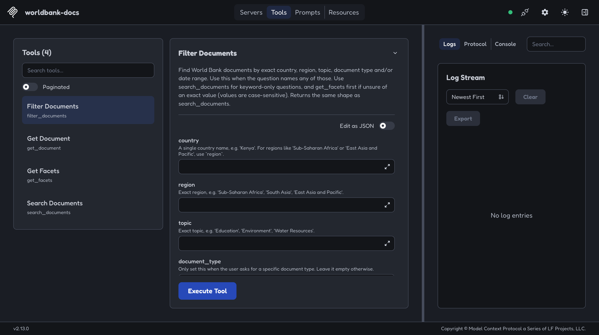

# World Bank Documents MCP server + local agent

An MCP server that wraps the public [World Bank Documents & Reports API](https://documents.worldbank.org/en/publication/documents-reports/api),
and a small agent client that lets a local LLM answer questions with real World Bank documents.

```
user ──> client/agent.py ──> Ollama (qwen2.5:7b) <──> MCP server (stdio, server/wb_docs_mcp.py) ──> World Bank API
```

The client starts the server as a subprocess, gives the model the four tools, runs every tool call the
model makes, feeds the results back, and prints the final answer. Tool calls go to stderr, the answer to stdout.

```
server/wb_docs_mcp.py      FastMCP server, 4 tools
client/agent.py            agent loop (OpenAI-compatible: Ollama by default, Groq via env vars)
ollama/Modelfile           wb-qwen = qwen2.5:7b, num_ctx 16384, temperature 0
scripts/run_eval.py        run the 6 test questions N times -> eval/runs/
scripts/check_citations.py replay checker (is every citation real?) + --self-test
eval/results.md            eval results
examples/                  one saved run per test question
tests/test_server.py       offline pytest suite
```

## Setup

Needs Python 3.10+ (FastMCP 4 requires it) and [Ollama](https://ollama.com).
**macOS's built-in `python3` is 3.9 and will not work:** `pip install` fails with
`No matching distribution found for fastmcp`. Use uv, which fetches Python 3.12 for you.

**1. Install uv** (skip if `uv --version` works; `brew install uv` also works):

```bash
curl -LsSf https://astral.sh/uv/install.sh | sh
```

Then open a new terminal so `uv` is on your PATH, and `cd` back into the project.

**2. Python environment.** On first run uv downloads Python 3.12 (~16 MB download, ~53 MB installed).

```bash
uv venv --python 3.12
source .venv/bin/activate
uv pip install -r requirements.txt
```

*Alternative without uv:* install Python 3.12 (e.g. `brew install python@3.12`), then
`python3.12 -m venv .venv && source .venv/bin/activate && pip install -r requirements.txt`.

**3. Start Ollama.** Install it from [ollama.com](https://ollama.com) (or `brew install ollama`). Either open
the Ollama app, or run this in a second terminal and leave it running:

```bash
ollama serve
```

**4. Model.** Back in the first terminal (the model download is ~4.7 GB):

```bash
ollama pull qwen2.5:7b
ollama create wb-qwen -f ollama/Modelfile
```

**Why `num_ctx 16384` matters.** Without it, Ollama runs qwen2.5:7b with a 4,096-token context
(measured on Ollama 0.40) and truncates the start of any longer conversation, which is where the system
prompt and tool schemas live. One search result can be ~3k tokens and a question often takes two tool
calls, so the agent needs room for the system prompt, four tool schemas, two results and the answer.
16384 holds that. The client caps each tool result at 12,000 characters (~3k tokens) to stay inside it.

## Run

```bash
python client/agent.py "Find the most recent economic sector work on Indonesia."
python client/agent.py          # interactive; blank line or Ctrl-D exits
```

## LLM choice: Ollama + qwen2.5:7b

- **Offline and free:** no API key, so a reviewer can run it with nothing but Ollama.
- **Reliable tool calling at 7B:** no malformed or unknown tool calls in any eval run
  ([eval/results.md](eval/results.md)).
- **Fast enough:** ~27 tok/s generation on an M-series Mac (measured 27.4–27.8 tok/s on an Apple M5);
  a question takes 10–70 s depending on how many tool calls it needs.

To use Groq instead, change only env vars:
`LLM_BASE_URL=https://api.groq.com/openai/v1 LLM_MODEL=llama-3.1-8b-instant LLM_API_KEY=<your key>`.
Defaults are `http://localhost:11434/v1`, `wb-qwen:latest`, `ollama`.

## Tools

| Tool | Purpose | Key args |
|---|---|---|
| `search_documents` | Keyword search over titles, abstracts, countries, project names | `query`, `language`, `rows` (1–20), `offset`, `newest_first` |
| `filter_documents` | Exact filters, optionally combined with keywords | `country`, `region`, `topic`, `document_type`, `major_document_type`, `start_date`/`end_date` (YYYY-MM-DD), `query`, `rows`, `offset`, `newest_first` |
| `get_document` | Every metadata field for one document | `document_id` |
| `get_facets` | Distinct values of a field with counts (discovery, "most common", exact spellings) | `field` (country, language, document_type, major_document_type, topic, theme, region), `query` |

Search and filter results return `total`, `next_offset` and trimmed documents: `id`, `display_title`,
`docdt`, `docty`, `majdocty`, `country`, `pdfurl` and an abstract cut to 300 characters.
`get_document` returns every field as the API sends it, except `keywd`, which is capped (below).

## What the live API actually does

All of these were found by calling the API, not from the docs:

- **`topic_exact` matches nothing.** The working topic field is `teratopic_exact`; the `topic` argument uses it.
- **Date sort is `srt=docdt&order=desc`.** `sort=` is silently ignored. Used by `newest_first`.
- **Exact filters are case-sensitive.** `count_exact=Kenya` gives 9,736 documents; `kenya` gives 0.
- **Facets return at most 100 values**, most common first. The country list is therefore incomplete.
- **A malformed date returns HTTP 500** with a server stack trace, so dates are validated before any call.
- **An offset above 100,000 returns HTTP 400**, so `offset` is capped at 100,000.
- **`count` is the API's country field** (e.g. `"count": "Kenya"`). Next to `total` and `returned` a
  model can read it as a number, so it is renamed to `country` in search/filter output. The rename keeps
  the field's position: a first version that moved `country` after `pdfurl` cut Q2 from 10 PDF links to 0
  in 3/3 runs (with `count` restored: 10 in 3/3).
- **`keywd` lists often run to 100–200 entries** (in a sample of 30 documents). `get_document` keeps the
  first 20 and adds `"keywd_truncated": true` when it cuts.
- **"Sub-Saharan Africa" is not a region value** (0 results). The region field (`admreg_exact`) splits
  it into "Eastern and Southern Africa" and "Western and Central Africa", plus an older "Africa" label.
  The server expands "Sub-Saharan Africa" to all three (`^` ORs values).
- **"Economic & Sector Work" is a broad type** (`majdocty_exact`), not a `docty_exact` value, hence the
  `major_document_type` argument.
- **Tie order is non-deterministic.** Identical queries can return a different document in the last
  slot when relevance scores tie (see [eval/results.md](eval/results.md)).

## Design choices for a small model

- **Flat schemas.** Every argument is top-level with a one-line description. No nested `params`
  object. Pydantic models still validate everything inside each tool.
- **Trimmed results.** Search results carry 8 fields and a 300-character abstract, not the 40+ fields the
  API returns. `get_document` is there when the model needs more.
- **Hints instead of exceptions.** Bad arguments and empty results come back as normal results with
  a one-line `message` the model can act on, e.g. *"No documents matched country='kenya'. Filter values
  are case-sensitive; call get_facets(field='country') to find the exact value, or drop a filter."*
  Only network/API failures raise.
- **Whole-document truncation.** If a result exceeds 12,000 characters, the client drops whole documents
  from the end and adds *"Showing 15 of 20 documents; call again with offset=15 for more."* The model
  never sees cut-off JSON.
- **Two-way region/country fallback.** A region passed as `country` is searched by region; a country passed
  as `region` (checked live, since the country facet stops at 100) is searched by country. Either way
  the result says so in a `note`.

## Iteration log

1. **First run:** Q2 put "Sub-Saharan Africa" in `country`, got 0 results, and asked the user a clarifying
   question instead of retrying. Q5 listed 10 of 100 languages.
   Fixes: clearer `country`/`region` descriptions, the region fallback, and system-prompt lines
   "never ask a clarifying question; follow the hint" and "list every value the tool returned".
2. **Regression:** I also switched `get_facets` to plain-text lines to help Q5. Q3 then listed document
   types in the wrong order with no counts. Rerunning with one change reverted at a time showed the
   cause: with text facets Q3 failed whether or not the new prompt lines were present; with JSON facets
   and the new lines it passed, and the prompt line alone was enough for Q5. Reverted to JSON.
3. **`rows=50` truncation:** the model began asking for 50 rows (22–31k characters). The original
   6,000-character cut showed it only 12–26 of them, as broken JSON. Fixes: `rows` max 20,
   "use 5–10", a 12,000-character cap, whole-document truncation.
4. **Counts-line experiment (reverted):** adding "When a tool returns counts, include them in the answer"
   made Q3 give correct counts, but Q5 still gave none and Q6 dropped its PDF links in 3/3 runs (links
   came back with the line removed). Correct citations matter more than counts, so the line was reverted.
5. **Field order (kept the rename, fixed the order):** moving `country` after `pdfurl` dropped Q2 from
   10/10 to 0/10 links per run. Field position in tool output affects what a 7B model copies.
6. **Result:** 18/18 over 3 runs per question with the final prompt ([eval/results.md](eval/results.md)).

## Verification

`scripts/check_citations.py` grades saved runs without trusting the model. For each run it re-executes the
logged tool calls, applies the client's own `fit()` truncation so it sees exactly what the model saw,
then checks that every cited title exists in those results with the stated date, that every link is a
`pdfurl` from them, and a per-question check (e.g. Q3 top 5 in order; any counts given must be correct).

`--self-test` builds answers from live results and plants an invented title, a wrong date, a fake link,
a swapped ranking and a wrong count. It confirms each is caught and that the real entries pass.

```bash
python scripts/run_eval.py --runs 3     # needs Ollama running
python scripts/check_citations.py
python scripts/check_citations.py --self-test
```

## Examples

Real runs from [examples/](examples/) (round A; Q2 is from the final set). Long lists are shortened with "…".

**Q2. Find documents about education financing in Sub-Saharan Africa published between 2019 and 2022.**

```
-> filter_documents {"region": "Sub-Saharan Africa", "topic": "Education", "start_date": "2019-01-01", "end_date": "2022-12-31", "rows": 10}
<- 6255 chars
```
```
1. **Final Evaluation of the Transparency of the Mauritanian Education Budget (TOME) Project**
   - Date: 2022-08-03
   - Document Type: Report
   - Major Document Type: Publications & Research
   - Country: Mauritania
   - [PDF Link](http://documents.worldbank.org/curated/en/352401647610255802/pdf/Final-Evaluation-of-the-Transparency-of-the-Mauritanian-Education-Budget-TOME-Project.pdf)
   - Abstract: This report is the final evaluation of the Transparency of the Mauritanian Education Budget (TOME) project …

2. **Cameroon - Systematic Country Diagnostic : An Update**
   - Date: 2022-06-30
   - Document Type: Systematic Country Diagnostic
   - Major Document Type: Country Focus
   - Country: Cameroon
   - [PDF Link](http://documents.worldbank.org/curated/en/446021657067054458/pdf/Cameroon-Systematic-Country-Diagnostic-An-Update.pdf)
…
10. **Chad - Education Sector Reform Project**
    - Date: 2022-04-30
    - Document Type: Implementation Completion and Results Report
    - Major Document Type: Project Documents
    - Country: Chad
    - [PDF Link](http://documents.worldbank.org/curated/en/833361653657080816/pdf/Chad-Education-Sector-Reform-Project.pdf)
    - Abstract: Ratings for the Education Sector Reform Project for Chad were as follows: …
```

**Q4. Find the most recent economic sector work on Indonesia.**

```
-> filter_documents {"country": "Indonesia", "newest_first": true, "rows": 1, "major_document_type": "Economic & Sector Work"}
<- 720 chars
```
```
The most recent economic sector work on Indonesia is titled "Indonesia - Country Private Sector Diagnostic". Here are the details:

- **Title**: Indonesia - Country Private Sector Diagnostic
- **Date**: 2026-10-05
- **Link**: [Download PDF](https://documents.worldbank.org/curated/en/099753310052628862/pdf/IDU-2c04a71f-c12a-4c70-b9f9-a1111c195bc1.pdf)

The abstract provides an overview of the document, noting that Indonesia has seen rapid economic growth and
significant poverty reduction, driven by the private sector. However, growth has slowed due to restrictions
that have insulated dominant firms, hindering investment in higher-productivity and higher-paying sectors.
```

**Q6. Find project documents related to water and sanitation in Brazil.**

```
-> filter_documents {"query": "sanitation", "rows": 10, "country": "Brazil", "major_document_type": "Project Documents", "topic": "Water Resources"}
<- 5418 chars
```
```
1. **Title**: Brazil - Minas Gerais Water Quality and Pollution Control Project
   - **Date**: 2000-05-05
   - **Abstract**: The outcome of the project is rated satisfactory. …
   - [PDF Link](http://documents.worldbank.org/curated/en/764031468020346795/pdf/multi-page.pdf)

2. **Title**: Concept Project Information Document-Integrated Safeguards Data Sheet - SABESP Improving Water and Sanitation Service Access - P165695
   - **Date**: 2018-06-07
   - [PDF Link](http://documents.worldbank.org/curated/en/253671528402594449/pdf/Concept-Project-Information-Document-Integrated-Safeguards-Data-Sheet-SABESP-Improving-Water-and-Sanitation-Service-Access-P165695.pdf)
…
4. **Title**: Brazil - Technical Assistance and Pilot Rural Water Supply and Sanitation Project
   - **Date**: 1993-01-12
   - [PDF Link](http://documents.worldbank.org/curated/en/375321468232734558/pdf/multi-page.pdf)
…
```

## Testing

### Server alone, in MCP Inspector

Requires Node. From the project root:

```bash
npx @modelcontextprotocol/inspector .venv/bin/python server/wb_docs_mcp.py
```

It opens in your browser. Newer Inspector versions show a server list first: click the toggle on the
server card to connect, then open the **Tools** tab to list and call the four tools.



*MCP Inspector v2.13 connected over stdio: the four tools, with `filter_documents` open to show its flat arguments.*

### Offline tests

Offline test suite (the HTTP helper is mocked, so nothing touches the network):

```bash
uv pip install -r requirements-dev.txt    # adds pytest; with plain venv: pip install -r requirements-dev.txt
pytest
```

It covers whole-document truncation and the offset note, the region/country fallback both ways, date
validation, the "no filters" hint, the unknown facet field hint, the `count` → `country` rename and the
`keywd` cap.

## Known limitations

- **Q1 wastes a call:** it first tries `topic="climate resilience"` (not a real topic), gets 0 results,
  then follows the hint to `search_documents`.
- **Q2 relevance:** only 3 of 10 cited titles are clearly about education. The model never puts
  "financing" into `query`.
- **Q6 returns older documents:** most date from 1985–2018, because results are sorted by relevance.
- **Q3 may omit counts:** it lists the most frequent document types in the correct order but usually
  without their counts. A prompt line that fixed this cost Q6 its PDF links, so it was reverted.
- **The model sometimes leaves out PDF links even when the API returns them:** seen in older Q2 runs
  (3 of 10 unlinked, though the API returns a `pdfurl` for all three) and in Q6 run 1 of the final set
  (no links). The final Q2 runs linked 10 of 10.
- **7B variance:** even at temperature 0, link inclusion varied between identical runs. Three runs per
  question is a small sample.
- **API limits:** facets stop at 100 values; tie order is non-deterministic.
